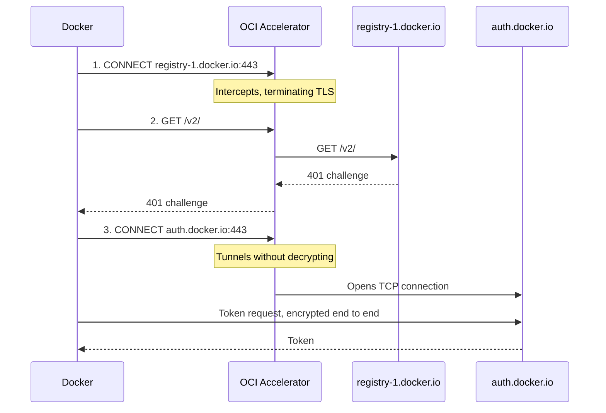
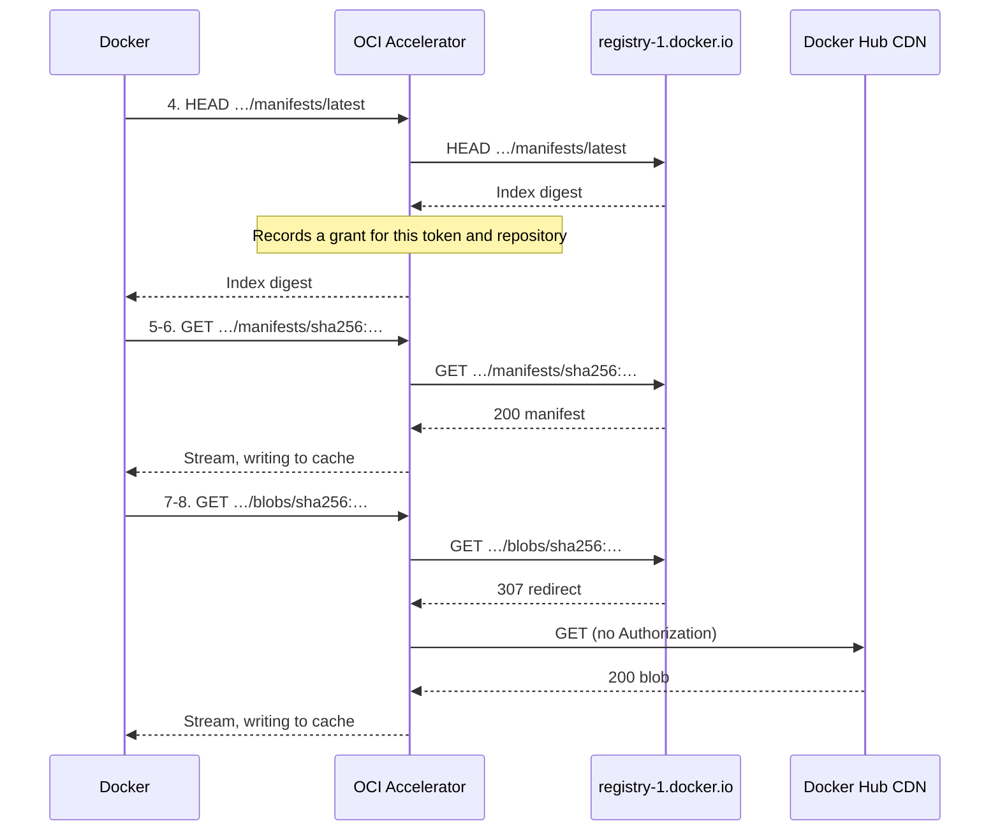
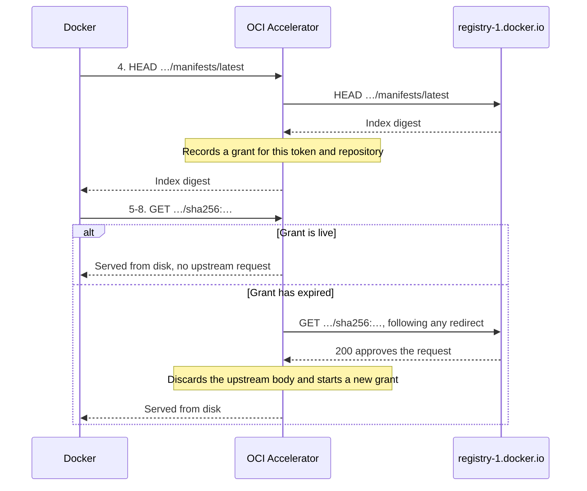

# How OCI Accelerator works

OCI Accelerator is a caching proxy for container image pulls. It sits between
Docker Engine and the upstream registries Docker pulls from, keeps a local disk
copy of the image content that passes through it, and serves repeated pulls of
that content from disk rather than downloading it again.

Docker does not need to know about the cache. It uses OCI Accelerator as an
ordinary HTTPS proxy and keeps its own image names, credentials, and login flow.
For each connection, the accelerator chooses one of two paths:

- **Configured registries are intercepted.** The accelerator decrypts the
  connection using a certificate signed by its own root CA, which Docker has
  been set up to trust. It can then see each registry request, forward it
  upstream over verified TLS, and cache the responses that are safe to reuse.
- **Everything else is tunneled.** Traffic to any other destination passes
  through unchanged, without being decrypted, inspected, or cached.

The disk cache holds only content addressed by SHA-256 digest, because a digest
always refers to the same bytes. It verifies each body against its digest
before storing it, and again on first use after a restart. A separate,
short-lived memory cache holds successful mutable metadata responses, which can
become stale before their fixed expiry.

This document starts with an overview of a pull, then explains each step in
the order a request meets it:
[interception](#trusting-the-accelerators-certificate),
[authorization](#authorizing-intercepted-requests),
[what gets cached](#what-gets-cached), and
[how the disk cache stores it](#disk-cache-storage).
[Peer discovery](#peer-discovery-and-cache-delivery), which is optional, comes
last.

## Request flow

The examples below follow a cold pull and then a warm pull of the same image
through the accelerator. The subsections after them cover how the accelerator
follows redirects and checks upstream addresses.

This is `docker pull alpine:latest` on a Docker host with an empty image store,
using the example configuration, which lists `registry-1.docker.io` in
`OCI_ACCELERATOR_REGISTRIES`. Paths are relative to `/v2/library/alpine`.

### Connecting and getting a token

The numbers match the steps in the diagrams.

1. `CONNECT registry-1.docker.io:443`: Docker opens a connection to Docker Hub.
   The accelerator intercepts it, terminating TLS with a certificate signed by
   its root CA.
2. `GET /v2/`: Docker checks the API. The accelerator forwards it, and the
   `401` challenge pointing to `auth.docker.io` passes back unchanged.
3. `CONNECT auth.docker.io:443`: Docker requests a pull token. The accelerator
   tunnels the exchange without decrypting it because the host isn't
   configured.

### Cold pull

With the token, Docker pulls the image.

4. `HEAD …/manifests/latest`: Docker resolves the tag to an index digest. The
   accelerator forwards the first request. An eligible `200` can establish this
   token's repository approval and briefly cache the HEAD response for
   independently approved tokens.
5. `GET …/manifests/sha256:<index>`: Docker fetches the image index. The
   accelerator streams it to Docker while writing it to disk, publishing after
   verifying length and digest.
6. `GET …/manifests/sha256:<manifest>`: Docker fetches its platform's manifest,
   which is cached as in step 5.
7. `GET …/blobs/sha256:<config>`: Docker fetches the image config. The
   accelerator follows the redirect to Docker Hub's CDN, dropping
   `Authorization` and other headers, and caches it as in step 5.
8. `GET …/blobs/sha256:<layer>`: Docker fetches each layer, which is handled as
   in step 7.

### Warm pull

A second Docker host then pulls the same image through the now warm cache. It
gets its own token in steps 1 to 3, as above.

4. `HEAD …/manifests/latest`: The tag lookup goes upstream, because the new
   token has no grant yet. If the registry's response allows it, the
   accelerator records a grant for that token and repository.
5. `GET …/sha256:…`, steps 5 to 8: While the grant is live, digest requests
   are served from disk without contacting the registry. Once it expires, the
   next request goes upstream for approval and starts a new grant, but the body
   still comes from disk.

### Redirects

The accelerator follows redirects itself for eligible digest-addressed GETs,
such as a blob redirected to a CDN, up to five HTTPS hops. A cacheable `200 OK`
at the end is returned to Docker and cached under the original request. Any
other final response goes back to Docker unchanged.

If the request or any redirect forbids caching, for example with `no-store`,
the accelerator still follows the redirects but doesn't cache the result. If
the chain runs past five hops, loops, or points to an unsafe or malformed
target, Docker gets `502 Bad Gateway`. Unsafe targets include non-HTTPS URLs,
URLs with userinfo or a fragment, unbracketed IPv6 addresses, and non-ASCII
hostnames. Internationalized names must use punycode (`xn--`).

Redirects for every other request, including mutable requests, go back to
Docker unchanged and are never cached.

When a redirect leads to a different origin (scheme, host, and port), the
accelerator sends only the `Accept`, `Accept-Encoding`, and `User-Agent`
headers, so credentials never leave the upstream registry's origin.

The accelerator sends each redirect target's host and port, in both the URL and
the `Host` header, exactly as `Location` wrote them. Presigned storage URLs
that sign the host, such as S3 URLs, therefore stay valid.

### Upstream address checks

The accelerator checks the address of every upstream connection it makes for an
intercepted registry, including redirects. Public hosts need no configuration,
but a private or internal address is refused unless its host and port belong to
a configured registry or are listed in `OCI_ACCELERATOR_REDIRECT_ALLOWLIST`.

## Trusting the accelerator's certificate

To intercept a registry connection, the accelerator presents its own
certificate for the upstream registry's host, signed by its self-signed root
CA. Docker rejects that certificate unless it trusts the root CA, so each
Docker host must install the CA certificate before pulling through the
accelerator.

The accelerator creates the root CA in `OCI_ACCELERATOR_CA_DIR` on first
startup, or with `init` or `init-ca`, and reuses it on every later startup. It
never replaces the CA automatically, so Docker hosts install it once. See
[CA management](deployment.md#ca-management).

The same CA signs the certificates instances use to authenticate each other
when [peering](#peer-discovery-and-cache-delivery) is enabled. Anyone holding
`ca.key` can impersonate any registry to Docker hosts that trust the CA, and
any peer to the fleet. See [peer trust](deployment.md#peer-trust).

Anyone who can reach the listener can fetch the exact path `/ca.crt` with `GET`
or `HEAD` over plain HTTP, without credentials. It serves only the running
process's public certificate, never the private key. Other methods return
`405`, and each response closes its connection. Because the download is
unauthenticated, Docker hosts must
[verify its fingerprint](deployment.md#trust-the-ca) before installing it.

### Per-host certificates

A TLS certificate is only valid for the names it lists, so each intercepted
host needs its own certificate chaining to the root CA. The accelerator signs
these on demand, the first time Docker connects to a host. So the root CA
doesn't depend on which registries you configure, and unused registries never
get a certificate.

- **One name each.** Each certificate covers a single DNS name or IP address.
- **Short-lived.** Certificates are valid for 24 hours. A new one is signed when
  the current one is within an hour of expiry, or isn't currently valid, for
  example after the system clock moves backwards.
- **Never outlive the root CA.** A certificate's validity is capped at the root
  CA's expiry. One that already expires with the root CA is reused even in its
  final hour, because renewing it can't extend its lifetime. If the root CA
  isn't currently valid, no certificate is signed or reused.
- **Memory only.** Certificates and their private keys are never written to
  disk. The accelerator keeps up to
  [`OCI_ACCELERATOR_MAX_LEAF_CERTIFICATES`](settings.md#connections-and-limits)
  and evicts the least recently used. Each use or renewal counts as recent.

## Authorizing intercepted requests

The upstream registry checks the credentials Docker sends, and the accelerator
holds no credentials of its own. To avoid an upstream request for every cache
hit, it can reuse a recent approval, called a grant, for a short, fixed time.

Grants for Bearer tokens cover a whole repository. This assumes your registry
decides pull permission per repository from the token alone, not from cookies,
other headers, or rules for individual objects. The accelerator doesn't read
token claims, scopes, or expiry.

A registry that doesn't fit, for example because it uses object-specific pull
ACLs, needs credentialed grants turned off. See
[authorization grants](deployment.md#authorization-grants).

### Approval before every delivery

A cached copy reaches Docker only after a recent approval. What counts as
approval, and what happens without one, depends on the content.

| Content | Reused without an upstream request when | Otherwise |
| --- | --- | --- |
| Digest manifests and blobs | The request has a live grant and the body is on disk | An upstream GET approves the request, then the body comes from disk, a peer, or origin |
| Tag manifests, tag lists, and referrer lists, for a Bearer token in shared mode | The token has a live repository grant and a matching entry is cached | The request goes upstream, and Docker gets the fresh response |
| Other mutable requests, including the catalog | An identical earlier request, including its credentials, is still cached | The request goes upstream, and Docker gets the fresh response |

Immutable content can come from the cache after a fresh approval, because a
digest always refers to the same bytes. Mutable content without approval never
comes from the cache, because a tag can move.

For digest-addressed content, the accelerator sends Docker's `GET` upstream
first, following any redirects. Only a cacheable `200 OK` counts as approval.
Any other response, such as `401` or `404`, goes back to Docker unchanged.
`GET /v2/` approves nothing.

After approval, the body can come from disk or a
[peer](#fetching-from-a-peer), but the upstream response always sets the cache
key, metadata, response headers, and whether a grant is created. A disk hit
without a reusable grant still sends the request upstream, including any
redirects, but doesn't download the body. These requests may count toward
registry rate limits.

### Authorization grants

A grant lets the accelerator reuse a recent upstream approval without contacting
the registry. Grants are kept in memory only, are cleared on restart, and share
the [authorization entry limit](settings.md#cache-authorization). Cached bytes
are shared, but approvals aren't. Any client the registry approves can receive a
cached copy, whoever filled it.

#### What creates a grant

An upstream GET for a digest manifest or blob creates a grant when its final
response, after any redirects, is a cacheable `200`.

For a Bearer token, a tag GET or HEAD, a tag-list GET, or a referrer-list GET
can also create or renew a repository grant. This needs
`OCI_ACCELERATOR_CACHE_MUTABLE_SHARED=true`, the default, and both
`OCI_ACCELERATOR_CACHE_MUTABLE_TTL` and
`OCI_ACCELERATOR_CACHE_AUTHORIZATION_TTL` above `0s`. Catalog requests, other
HEADs, writes, and cache hits never create a grant.

No grant is created if the request or any response in the redirect chain has
any of the following:

- `Cache-Control: no-cache`, `no-store`, `private`, `min-fresh`, or a zero
  `max-age` or `s-maxage`
- `Pragma`
- an authentication header (`Set-Cookie`, `WWW-Authenticate`,
  `Authentication-Info`, `Proxy-Authentication-Info`)

These headers only prevent a grant. See [what gets cached](#what-gets-cached)
for which responses are still written to disk.

#### What a grant covers

| Grant | Who gets it | What it covers |
| --- | --- | --- |
| Repository | A request with a single valid, nonempty Bearer token | That token, registry, and repository: digest manifests, blobs including ranges, and shared mutable entries |
| Exact-request | Every other request, including anonymous requests and empty, malformed, or multiple Bearer credentials | Only a request with the same URL and forwarded headers. The same applies to exact-request mutable entries and waiting for them. Ranged requests always go upstream |

Other forwarded headers don't change which repository grant applies. A new or
rotated token must get its own upstream approval and can't use another token's
grant. An anonymous grant never serves a request carrying `Authorization`, even
if `Connection` strips that header before forwarding.

Every reader of a shared mutable entry needs its own grant, including to wait
for a capture in progress, so an entry can outlive the approval of the token
that filled it.

#### How long it lasts

`OCI_ACCELERATOR_CACHE_ANONYMOUS_AUTHORIZATION_TTL` sets the lifetime for
requests without `Authorization`. `OCI_ACCELERATOR_CACHE_AUTHORIZATION_TTL`
sets it for requests with `Authorization`, even an empty one. See
[cache authorization](settings.md#cache-authorization) for the defaults. A
value of `0s` turns off reuse for that kind of request, and `0s` for both also
turns off the mutable response cache.

A grant's lifetime is measured from the earliest response headers in the
redirect chain. Hits don't extend it, and nothing refreshes it in the
background. `Age`, `Date`, and `Expires` are ignored, so a grant can last its
full TTL even if the upstream response was already old.

A shorter `max-age` or `s-maxage` on the request or any response shortens the
grant. A request `max-age` below the credentialed TTL always goes upstream
instead of using a Bearer repository grant. A restricted Bearer request, with
`If-*` headers or a header from the [no-grant list](#what-creates-a-grant),
always goes upstream, and a `200` or `304` keeps the existing grant's expiry
without renewing it.

#### What revokes it

A Bearer repository grant is revoked when any redirect hop or the final
response has any of the following, even for a request that had to revalidate:

- a `401` or `403`
- an authentication header
- headers that would prevent a grant, such as `no-store`, `private`, `Pragma`,
  or `max-age=0`, or a malformed `max-age` or `s-maxage`
- a `Vary` the accelerator can't key on, or a digest mismatch

A later successful response can't restore a revoked grant.

For tag and listing responses in shared mode, only `Vary: *` or
`Vary: Authorization` counts, and there's no digest check. A `404`, `410`, or
transient failure doesn't revoke a grant on its own. A restricted request also
revokes it if it gets an unexpected status, such as a redirect, `400`, `412`,
or `416`.

An exact-request grant is revoked by any later response to the same request
that doesn't create a new grant, except a transient failure. A denial or a
non-transient response that can't be reused likewise discards a cached
exact-request mutable entry, even one still being captured.

Tokens are opaque to the accelerator, so an expired or revoked token keeps its
grant until the grant expires. Revoking a repository grant stops both immutable
and [mutable](#mutable-response-caching) reuse for that token, but doesn't
purge cached bytes or other tokens' grants. An upstream failure always goes
back to Docker and is never hidden by cached content.

## What gets cached

| Request | Content | Cached |
| --- | --- | --- |
| `GET /v2/<name>/blobs/sha256:<digest>` | Layer or image config | On disk |
| `GET /v2/<name>/manifests/sha256:<digest>` | Manifest or image index, by digest | On disk |
| `GET`, `HEAD` `/v2/<name>/manifests/<tag>` | Manifest by tag, which can be moved | Briefly in memory |
| `GET /v2/<name>/tags/list` | Repository's tags | Briefly in memory |
| `GET /v2/<name>/referrers/<digest>` | Referrers, including filter variants | Briefly in memory |
| `GET /v2/_catalog` | Registry catalog | Briefly in memory |
| `GET /v2/` | API version and authentication check | No |
| `PUT`, `PATCH`, `POST`, `DELETE` | Pushes and deletions | No |

Other requests, such as HEAD requests for digests and digest GETs with a query
string, aren't cached either.

`no-store`, an unsupported `Vary`, a digest mismatch, an encoded or
unknown-length body, trailers, or an unsupported media type keeps a
digest-addressed `200` off disk. A response marked `private` or `no-cache`, or
carrying `Pragma` or an authentication header, is still cached. Later clients
can receive it after their own upstream approval.

See [mutable response caching](#mutable-response-caching) for how responses
are kept briefly in memory.

### Ranges and conditional requests

A blob request with a `Range` header, such as a resumed layer download, goes
upstream as a request for the whole blob. Docker still gets only the bytes it
asked for. They come from disk if the blob is cached, or otherwise from the
origin or peer stream that fills the cache.

A cache hit supports single, suffix, and multipart ranges. Before the blob is
cached, a single range is cut from the full stream and returned as `206`, and a
request for more than one range gets the full `200`.

The fill continues after the range ends or Docker disconnects, until
`OCI_ACCELERATOR_CACHE_FILL_TIMEOUT` expires. A range can finish before the
digest is checked, but a fill that fails later is never cached or retried from
origin.

Only Bearer repository grants apply to ranges. See
[what a grant covers](#what-a-grant-covers).

These requests are forwarded upstream unchanged and not cached:

- a manifest request with a `Range` header
- any request with an `If-*` header, including `If-Range`
- a `no-store` request
- a request whose `Connection` header names `Range`

### Mutable response caching

Successful `200` responses to tag manifest GETs and HEADs, tag lists, digest
referrer lists, and the registry catalog are kept in memory for a short time
and reused without another upstream request. Only bodyless requests with
unambiguous, unescaped paths qualify. The cache isn't persisted or shared with
peers.

#### Shared and exact-request entries

With `OCI_ACCELERATOR_CACHE_MUTABLE_SHARED=true`, the default, Bearer tokens
approved for the same repository share cached tag manifests, tag lists, and
referrer lists. All other requests, including catalog and anonymous requests,
use exact-request entries. Each reader still needs its own
[approval](#approval-before-every-delivery).

A shared entry matches the method, the exact URL and query, and every forwarded
header except `Authorization`. An exact-request entry matches all of those,
including credentials. So GET and HEAD, and each listing page or filter, are
separate entries.

Sharing assumes your registry returns the same metadata to every token approved
for the repository. `OCI_ACCELERATOR_CACHE_MUTABLE_SHARED=false` makes every
request use exact-request entries, for registries that filter metadata per
token. See [stale mutable metadata](deployment.md#stale-mutable-metadata).

#### Lifetime

[`OCI_ACCELERATOR_CACHE_MUTABLE_TTL`](settings.md#mutable-cache) sets how long
an entry lasts, from when the upstream response headers arrive. A value of `0s`
turns off mutable caching. Hits never extend an entry.

An exact-request entry is also capped by the matching authorization TTL.

Nothing else invalidates an entry early, so a tag move, push, or access
revocation takes effect only when the entry expires. Hits send
`Cache-Control: private, no-store` to Docker, so no other cache can extend that
window. See [stale mutable metadata](deployment.md#stale-mutable-metadata).

#### What isn't reused

Request cache restrictions, such as `no-cache` or a `max-age` limit, are
honored. A response with `no-store`, `no-cache`, `private`, `Pragma`, an
authentication header, or `Vary: *` isn't reused, and in shared mode neither is
one with `Vary: Authorization`. Other `Vary` headers are covered, because
entries match the full request.

Upstream `max-age`, `s-maxage`, `Date`, `Age`, and `Expires` don't change an
entry's lifetime. They can still prevent or revoke a grant, so after
`max-age=0` an entry stays available to other approved tokens until it expires.

Conditional and range requests bypass this cache. Errors, denials, redirects,
responses with trailers, and incomplete or oversized bodies are never cached.
A GET body streams to Docker while it's captured, and dropping a capture
doesn't affect the response. HEAD entries store headers only.

#### Limits and waiting

Captures and stored responses share fixed limits on total memory, body and
header size per response, concurrent captures, and entries including captures
in progress. See [built-in limits](deployment.md#built-in-limits) for the
values. Each capture counts as full size until it finishes. These limits don't
bound the process's total memory use.

An [approved](#what-a-grant-covers) request can wait up to
[`OCI_ACCELERATOR_CACHE_FILL_WAIT_TIMEOUT`](settings.md#cache-storage) for a
matching capture in progress instead of fetching upstream. After a timeout or
failed capture, it fetches upstream without trying to cache. Setting the timeout
to `0s` turns off waiting, not caching.

## Disk cache storage

The disk cache lives in `OCI_ACCELERATOR_CACHE_DIR`. See
[cache storage](deployment.md#cache-storage) for its directory requirements,
settings, operations, and how to reset the cache.

### Entries

Each cached object is stored as a body file and a small JSON metadata file:

| Field | Contents |
| --- | --- |
| `Key` | SHA-256 of the registry, repository, object kind, digest, `Accept`, and `Content-Type`, as 64 hex characters |
| `Digest` | The object's `sha256:` digest |
| `Size` | Body length in bytes |
| `MediaType` | The response's `Content-Type` |
| `RequestKey` | SHA-256 of the registry, repository, object kind, digest, and ordered `Accept` values, as 64 hex characters |
| `committed` | Commit time, in Unix nanoseconds |

Both keys are hashes, so the metadata file stores no raw request headers or
credentials. Because the key covers the registry, repository, `Accept`, and
`Content-Type`, the same layer can be stored more than once. That happens when
two repositories use it, or when clients send different `Accept` headers.

`RequestKey` leaves out `Content-Type`, which isn't known until the response
arrives. It lets a live [repository grant](#what-a-grant-covers) find a local
entry without an upstream request. If more than one entry matches, the request
goes upstream as usual.

### Filling

If the cache admits a miss, the body streams to Docker while it's written to a
temporary file.

The entry is published, with an atomic rename, only after the full length and
SHA-256 digest match. The temporary file is discarded if the download fails,
Docker disconnects from a non-ranged request, the digest doesn't match, or the
fill runs past `OCI_ACCELERATOR_CACHE_FILL_TIMEOUT`, which includes the time
Docker takes to read the body. A download slower than the timeout still
reaches Docker in full.

Only one request fills an entry at a time. Others for the same object still
get their own upstream approval, then wait up to
`OCI_ACCELERATOR_CACHE_FILL_WAIT_TIMEOUT` for the fill instead of downloading
again. After a timeout, failed fill, or eviction, they retry once upstream. If
the first fill is still running, the retry downloads without caching. A waiting
request that disconnects doesn't affect the fill.

### Limits and eviction

[`OCI_ACCELERATOR_CACHE_MAX_BYTES`, `OCI_ACCELERATOR_CACHE_MAX_ENTRIES`, and
`OCI_ACCELERATOR_CACHE_MAX_FILLS`](settings.md) limit the cache. Each entry
counts its body plus 4 KiB of metadata toward the byte limit. Fills in
progress, and entries whose removal failed, count toward these limits.

When a new entry doesn't fit, the accelerator evicts approximately
least-recently-used entries, skipping any that are being read. Each new entry
removes at most eight old ones. If that still isn't enough room, the object
streams to Docker without being cached, though the entries evicted for it stay
gone.

### Restarts and integrity

Startup removes incomplete or unsafe entries and evicts the oldest if the
cache no longer fits. See [startup recovery](deployment.md#startup-recovery).

Each body is fully hashed on its first read after startup. Later reads check
only the file size and rely on the directory's private permissions. A failed
hash or a read error makes the entry a miss, and a read error mid-stream also
cuts that response short.

## Peer discovery and cache delivery

Instances that share a CA can enable a separate peer listener and download
cached content from each other instead of from origin. See
[peer discovery](deployment.md#peer-discovery) to set it up and the
[peer protocol](peer-protocol.md) for wire-level details.

### Trust and membership

Mutual TLS verifies dedicated peer certificates against the shared CA on both
sides, so the public CA certificate alone grants no access. Because every
instance holds the shared signing key, authentication establishes fleet
membership, not trusted identities. Node IDs are self-asserted.

Each instance keeps a random node ID across restarts and address changes.
Startup checks briefly for collisions and stops if its kept ID belongs to
another address. See [node IDs](peer-protocol.md#node-ids) for the rules.

Instances exchange their advertised address, node ID, and known address-to-ID
mappings. Gossip and inbound contact introduce candidates, not members. A
candidate becomes a member only after this instance successfully contacts its
advertised address. For example, if A knows B and B knows C, A learns about C
through B but doesn't advertise C until it contacts C itself.

Membership expires after a fixed time without successful outbound contact
([expiry](peer-protocol.md#capacity-and-expiry)). Gossip and inbound contact
don't extend it, and expired peers aren't advertised or chosen as providers. A
returning peer can contact a live member, which probes it back before restoring
membership.

### Cache key hints

Each instance lists the hashed keys of its committed cache entries to
authenticated peers. Other instances poll those listings in the background:

- a full scan at startup and when a new node ID appears
- incremental polls about once a minute
- a full rescan about once an hour

See [hint fetching](peer-protocol.md#hint-fetching) for the polling and
recovery rules, and [peering hints](settings.md#peering-hints) for the timing
settings.

Hints are advisory and grant no access. They record which peer claimed which
object. Neither a full scan nor an empty listing removes a claim. A claim is
removed only when that peer answers `404` for the object, or when the hint
index, shared by all peers, fills and drops the oldest
([details](peer-protocol.md#hint-fetching)).

### Fetching from a peer

For a digest-addressed blob or manifest GET that it can cache, the
accelerator:

1. Gets [upstream approval](#approval-before-every-delivery). Every local miss
   needs its own upstream GET, even with a live grant.
2. Uses a local entry, or waits for a fill already in progress.
3. Otherwise, picks one live hinted peer at random and tries no other.

The peer serves only a committed entry with the same [cache key](#entries). A
layer cached under another repository isn't shared.

Until the peer's response headers pass validation, the approved origin stream
stays open. A missing, busy, unreachable, or incompatible peer falls back to it
without another GET.

Once the peer is accepted, the origin stream closes and only the body comes
from the peer. Docker still gets the origin response's headers. A failure after
this point, including a transfer that runs past
`OCI_ACCELERATOR_CACHE_FILL_TIMEOUT`, fails the request rather than splicing in
origin bytes.

Bytes reach Docker before the digest is checked. If the check fails, the
accelerator withholds the last chunk and returns an error, so Docker can't
mistake the delivery for complete. A range that ends before the blob does
doesn't wait for the check, so its bytes rely on fleet trust.

### What peers can and can't do

Connections for intercepted registries pass destination checks, but peer
connections don't. A peer can make an instance connect to any address it names.

Peers share cached content within the fleet, never registry credentials or
authorization grants. The serving peer trusts fleet membership, and the
requesting instance remains responsible for upstream authorization.
