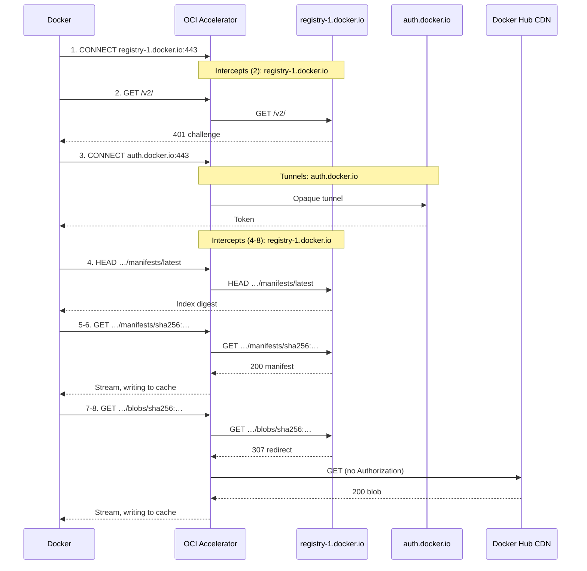

# How OCI Accelerator works

OCI Accelerator is a caching proxy for container image pulls. It sits between
Docker Engine and the upstream registries Docker pulls from, keeps a local disk
copy of the image content that passes through it, and serves repeated pulls of
that content from disk rather than downloading it again.

Docker does not need to know about the cache. It uses OCI Accelerator as an
ordinary HTTPS proxy and keeps its own image names, credentials, and login flow.
For each connection, the accelerator chooses one of two paths:

- **Configured registries are intercepted.** The accelerator decrypts the
  connection using a certificate signed by its own root CA, which Docker has
  been set up to trust. It can then see each registry request, forward it
  upstream over verified TLS, and cache the responses that are safe to reuse.
- **Everything else is tunneled.** Traffic to any other destination passes
  through unchanged, without being decrypted, inspected, or cached.

The accelerator only caches content addressed by SHA-256 digest, because a
digest always refers to the same bytes. It checks every stored byte against its
digest, so a cached copy is always identical to what the upstream registry would
send.

| Cached                                     |                                    |
| ------------------------------------------ | ---------------------------------- |
| `GET /v2/<name>/blobs/sha256:<digest>`     | Layer or image config              |
| `GET /v2/<name>/manifests/sha256:<digest>` | Manifest or image index, by digest |

| Not Cached                       |                                      |
| -------------------------------- | ------------------------------------ |
| `GET /v2/<name>/manifests/<tag>` | Manifest by tag, which can be moved  |
| `GET /v2/<name>/tags/list`       | Repository's tags                    |
| `GET /v2/`                       | API version and authentication check |
| `PUT`, `PATCH`, `POST`, `DELETE` | Pushes and deletions                 |

A blob request with a `Range` header, such as a resumed layer download, is sent
upstream as a request for the whole blob, so the upstream registry still approves every
request. The accelerator then returns only the requested bytes, reading them
from disk if the blob is cached or from the upstream stream while filling the
cache. A ranged fill continues after Docker disconnects, until
`OCI_ACCELERATOR_CACHE_FILL_TIMEOUT` expires. Ranged requests never use authorization grants. A
manifest request with a `Range` header, or any request with an `If-*` header, is
forwarded upstream unchanged and not cached.

When a registry redirects a cacheable request, for example to a CDN, the
accelerator follows up to five HTTPS redirects itself. If the final response is
a cacheable `200 OK`, it returns that to Docker and caches it under the original
request. Any other final response goes back to Docker unchanged. When a redirect
leads to a different origin (scheme, host, and port), the accelerator sends only
the `Accept`, `Accept-Encoding`, and `User-Agent` headers, so credentials never
leave the upstream registry's origin.

The accelerator checks the address of every upstream connection it makes for an
intercepted registry, including redirects. Public hosts need no configuration,
but a private or internal address is refused unless its host and port belong to
a configured registry or are listed in `OCI_ACCELERATOR_REDIRECT_ALLOWLIST`.

### Play-by-play example

This is `docker pull alpine:latest` on a Docker host with an empty image store,
using the example configuration, which lists `registry-1.docker.io` in
`OCI_ACCELERATOR_REGISTRIES`. Paths are relative to `/v2/library/alpine`.

| #   | Request                             | What happens                                                                                                                                                             |
| --- | ----------------------------------- | ------------------------------------------------------------------------------------------------------------------------------------------------------------------------ |
| 1   | `CONNECT registry-1.docker.io:443`  | Docker opens a connection to Docker Hub <br> _The accelerator intercepts it, terminating TLS with a certificate signed by its root CA._                                  |
| 2   | `GET /v2/`                          | Docker checks the API <br> _The accelerator forwards it. The `401` challenge pointing to `auth.docker.io` passes back unchanged._                                        |
| 3   | `CONNECT auth.docker.io:443`        | Docker requests a pull token <br> _The accelerator tunnels the exchange without decrypting it because the host isn't configured._                                        |
| 4   | `HEAD …/manifests/latest`           | Docker resolves the tag to an index digest <br> _The accelerator forwards it because tags can move._                                                                     |
| 5   | `GET …/manifests/sha256:<index>`    | Docker fetches the image index <br> _The accelerator streams it to Docker while writing it to disk, publishing after verifying length and digest._                       |
| 6   | `GET …/manifests/sha256:<manifest>` | Docker fetches its platform's manifest <br> _Cached as in step 5._                                                                                                       |
| 7   | `GET …/blobs/sha256:<config>`       | Docker fetches the image config <br> _The accelerator follows the redirect to Docker Hub's CDN, dropping `Authorization` and other headers, and caches it as in step 5._ |
| 8   | `GET …/blobs/sha256:<layer>`        | Docker fetches each layer <br> _Handled as in step 7._                                                                                                                   |




<br>

# Trusting the accelerator's certificate

To intercept a registry connection, the accelerator presents its own certificate
for the upstream registry's host, signed by its self-signed root CA. Docker rejects that
certificate unless it trusts the root CA, so each Docker host must install the
CA certificate before pulling through the accelerator.

The accelerator creates the root CA on first startup, when the directory specified by
`OCI_ACCELERATOR_CA_DIR` doesn't exist yet, or with `oci-accelerator init-ca --dir <dir>`.
It stores the CA there as `ca.crt` and `ca.key`. It reuses the same CA on every later
startup, so Docker hosts only need to install it once. It never replaces the CA
automatically. If the directory exists but either file is missing, the accelerator
fails to start.

Any client that can reach the accelerator's listener can download the public
certificate over plain HTTP, without authentication:

```sh
curl --noproxy '*' --fail --output ca.crt http://127.0.0.1:3128/ca.crt
```

The endpoint serves only the public certificate, never the private key.

### Per-registry certificates

A TLS certificate is only valid for the names it lists, so each intercepted
host needs its own certificate chaining to the root CA. The accelerator signs
these on demand, the first time Docker connects to a host. That keeps the root
CA independent of the `OCI_ACCELERATOR_REGISTRIES` list, and no certificate is created for a
registry that is never used.

- **One name each.** Each certificate covers a single DNS name or IP address.
- **Short-lived.** Certificates are valid for 24 hours. A new one is signed when
  the current one is within an hour of expiry, or isn't currently valid, for
  example after the system clock moves backwards.
- **Never outlive the root CA.** A certificate's validity is capped at the root
  CA's expiry. One that already expires with the root CA is reused even in its
  final hour, because renewing it can't extend its lifetime. If the root CA
  isn't currently valid, no certificate is signed or reused.
- **Memory only.** Certificates and their private keys are never written to
  disk. The accelerator keeps up to `OCI_ACCELERATOR_MAX_LEAF_CERTIFICATES` (256 by default)
  and evicts the least recently used. Each use or renewal counts as recent.

# Authorizing intercepted requests

The accelerator makes no access decisions of its own. The upstream registry
decides who can pull what, using the credentials Docker sends, and the
accelerator only serves cached content that the registry has approved. It does
not read tokens, check their scopes or expiry, or hold credentials of its own.

### Approval on each request

Without a reusable authorization grant, the accelerator sends Docker's cacheable
`GET` upstream first, following any redirects. Only a cacheable `200 OK` counts as approval.
The body then comes from disk if cached, or streams from upstream while filling
the cache. Any other response, such as `401` or `404`, goes back to Docker
unchanged. `HEAD`, `GET /v2/`, and tag requests approve nothing.

A cache hit without a reusable grant still sends the request upstream, including
any redirects, though not the download, and may count toward registry rate limits.

### Authorization grants

After an approval, an identical request can be served from disk without contacting
the upstream registry. `OCI_ACCELERATOR_CACHE_ANONYMOUS_AUTHORIZATION_TTL` defaults to 15 minutes
for requests without `Authorization`. `OCI_ACCELERATOR_CACHE_AUTHORIZATION_TTL` independently
defaults to 30 seconds for requests with `Authorization`, including an empty value.
Set either TTL to `0s` to disable reuse for that class. Setting both to `0s` checks
the upstream registry on every delivery.

- **Identical requests only.** Grants match on the URL and every forwarded header.
  Requests with different `Authorization`, cookies, or other header values do not
  share approvals. Anonymous approvals cannot serve requests carrying `Authorization`.
- **Fixed lifetime.** It starts at approval, and hits don't extend it. A shorter
  `max-age` or `s-maxage` on the request or any response shortens it.
- **Memory only.** Grants are never persisted, are cleared on restart, and both
  classes share the `OCI_ACCELERATOR_CACHE_MAX_AUTHORIZATION_ENTRIES` bound (10000 by default).
- **Bytes are shared, approvals are not.** Any client the upstream registry approves can
  receive the cached copy, whoever filled it.

If you make a public repository private, an existing anonymous approval can still
serve an identical request until it expires, up to 15 minutes by default.

No grant is created if the request or any response in the redirect chain has
any of the following:

- `Cache-Control: no-cache`, `no-store`, `private`, `min-fresh`, or a zero
  `max-age` or `s-maxage`
- `Pragma`
- an authentication header (`Set-Cookie`, `WWW-Authenticate`,
  `Authentication-Info`, `Proxy-Authentication-Info`)

# Cache storage and eviction

The cache lives in `OCI_ACCELERATOR_CACHE_DIR` on local disk. The directory must be private to
the accelerator's user, and a lock file ensures only one accelerator process
uses it at a time. A second process fails to start.

### Entries

Each cached object is stored as a body file and a small JSON metadata file:

| Field       | Contents                                                                                                     |
| ----------- | ------------------------------------------------------------------------------------------------------------ |
| `Key`       | SHA-256 of the registry, repository, object kind, digest, `Accept`, and `Content-Type`, as 64 hex characters |
| `Digest`    | The object's `sha256:` digest                                                                                |
| `Size`      | Body length in bytes                                                                                         |
| `MediaType` | The response's `Content-Type`                                                                                |
| `committed` | Commit time, in Unix nanoseconds                                                                             |

The key is a hash, so the metadata file stores no request headers or
credentials. Entries are not shared between repositories, so a layer used by two
repositories is stored twice.

### Filling

On a cache miss, the accelerator streams the body to Docker while writing it to
a temporary file. It publishes the entry, with an atomic rename, only after the
full length and SHA-256 digest match. If the download fails, the client
disconnects from a non-ranged request, or the digest doesn't match, the
temporary file is discarded, so a partial entry is never served.

Only one request fills a given entry at a time. Other requests for the same
object still get their own upstream approval, then wait up to
`OCI_ACCELERATOR_CACHE_FILL_WAIT_TIMEOUT` (1 second by default) for the fill to finish instead
of downloading the body again. If it doesn't finish in time, each makes one
fresh upstream request.

### Limits and eviction

| Environment variable                 | Default | Limits                                                 |
| ------------------------------------ | ------- | ------------------------------------------------------ |
| `OCI_ACCELERATOR_CACHE_MAX_BYTES`     | 32 GiB  | Total size, counting each body plus 4 KiB of metadata    |
| `OCI_ACCELERATOR_CACHE_MAX_ENTRIES`   | 100000  | Number of entries                                      |
| `OCI_ACCELERATOR_CACHE_MAX_FILLS`     | 16      | Concurrent fills. Further misses stream without caching |
| `OCI_ACCELERATOR_CACHE_FILL_TIMEOUT`  | 10m     | How long a fill may take                                |

In-progress fills count toward these limits. The limits don't include filesystem
block and inode overhead, so leave some headroom on the disk.

When a new entry doesn't fit, the accelerator evicts approximately
least-recently-used entries, skipping any that are being read. Each new entry
removes at most eight old ones. If that still isn't enough room, the object is
streamed to Docker without being cached rather than failing the request.

### Restarts and integrity

Cached entries persist across restarts. On startup, the accelerator removes
abandoned temporary files and incomplete entries, and refuses to start if it
finds files it doesn't recognize, rather than deleting them. Recency order is
rebuilt from commit times.

Each body is hashed again, in full, before it is first served after startup, so
that first hit is slower. A missing or corrupt entry is treated as a miss and
refilled from the upstream response. Don't edit or delete files in a live cache.
To reset it, stop the accelerator and remove the whole directory.
