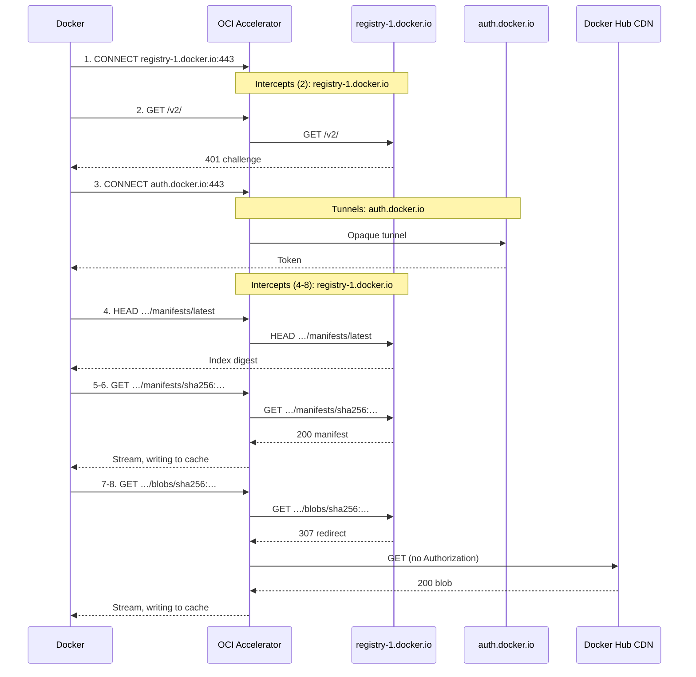

# How OCI Accelerator works

OCI Accelerator is a caching proxy for container image pulls. It sits between
Docker Engine and the upstream registries Docker pulls from, keeps a local disk
copy of the image content that passes through it, and serves repeated pulls of
that content from disk rather than downloading it again.

Docker does not need to know about the cache. It uses OCI Accelerator as an
ordinary HTTPS proxy and keeps its own image names, credentials, and login flow.
For each connection, the accelerator chooses one of two paths:

- **Configured registries are intercepted.** The accelerator decrypts the
  connection using a certificate signed by its own root CA, which Docker has
  been set up to trust. It can then see each registry request, forward it
  upstream over verified TLS, and cache the responses that are safe to reuse.
- **Everything else is tunneled.** Traffic to any other destination passes
  through unchanged, without being decrypted, inspected, or cached.

The disk cache holds only content addressed by SHA-256 digest, because a
digest always refers to the same bytes. It checks every stored body against its
digest. A separate, short-lived memory cache holds successful mutable metadata
responses, which can become stale before their fixed expiry.

| Cached on disk                             |                                    |
| ------------------------------------------ | ---------------------------------- |
| `GET /v2/<name>/blobs/sha256:<digest>`     | Layer or image config              |
| `GET /v2/<name>/manifests/sha256:<digest>` | Manifest or image index, by digest |

| Cached briefly in memory                        |                                      |
| ----------------------------------------------- | ------------------------------------ |
| `GET`, `HEAD /v2/<name>/manifests/<tag>`          | Manifest by tag, which can be moved   |
| `GET /v2/<name>/tags/list`                       | Repository's tags                    |
| `GET /v2/<name>/referrers/<digest>`              | Referrers, including filter variants |
| `GET /v2/_catalog`                              | Registry catalog                     |

Queries identify distinct mutable responses, including listing pages and filters.
GET and HEAD are separate entries. See [mutable response caching](#mutable-response-caching)
for eligibility, lifetime, and resource limits.

| Not cached                      |                                      |
| ------------------------------- | ------------------------------------ |
| `GET /v2/`                       | API version and authentication check |
| `PUT`, `PATCH`, `POST`, `DELETE` | Pushes and deletions                 |

A blob request with a `Range` header, such as a resumed layer download, is sent
upstream as a request for the whole blob unless a live Bearer repository grant
allows a verified committed local hit. The accelerator then returns only the requested bytes, reading them
from disk if the blob is cached or from a full origin or peer stream while filling
the cache. A ranged fill continues after Docker disconnects, until
`OCI_ACCELERATOR_CACHE_FILL_TIMEOUT` expires. Eligible blob ranges can use Bearer
repository grants, and their successful full upstream GETs can establish them. A
manifest request with a `Range` header, or any request with an `If-*` header, is
forwarded upstream unchanged and not cached.

When a registry redirects an eligible digest-addressed GET, for example to a CDN, the
accelerator follows up to five HTTPS redirects itself. If the final response is
a cacheable `200 OK`, it returns that to Docker and caches it under the original
request. Any other final response goes back to Docker unchanged. When a redirect
leads to a different origin (scheme, host, and port), the accelerator sends only
the `Accept`, `Accept-Encoding`, and `User-Agent` headers, so credentials never
leave the upstream registry's origin. The accelerator sends each redirect
target's host and port, in both the URL and the `Host` header, exactly as
`Location` wrote them, so presigned storage URLs that sign the host, such as S3
URLs, stay valid.

Mutable requests retain single-hop forwarding. Their redirects pass back to
Docker unchanged and are never cached.

The accelerator checks the address of every upstream connection it makes for an
intercepted registry, including redirects. Public hosts need no configuration,
but a private or internal address is refused unless its host and port belong to
a configured registry or are listed in `OCI_ACCELERATOR_REDIRECT_ALLOWLIST`.

### Peer discovery and cache delivery

You can enable a separate TLS listener for instances sharing the same CA. Mutual
TLS verifies dedicated peer certificates against that CA on both sides. Possessing
the public CA certificate alone does not grant access. Because each instance holds
the shared signing key, authentication establishes fleet membership rather than
independently trusted node identities.

Each instance persists a random 12-character node ID across restarts and address
changes. Before readiness, startup makes a best-effort collision check using
mutual TLS `GET /v1/peers` read-only snapshots. A fresh ID matching a retained ID
or an ID in the first successful snapshot is regenerated before persistence or
advertisement. A persisted ID is never rotated. Startup probes the original
retained peers and seeds, plus gossip addresses claiming that ID, prioritizing
addresses already associated with the local ID. Only a responder's own claim
of the same ID at a different advertised address rejects startup, without
changing the identity or book mappings. Stale gossip and aliases responding with
this instance's advertised address do not reject startup. Snapshot lookup and
probes share one five-second total network budget. Inconclusive checks allow
startup, so concurrent joins and partitions can still hide collisions. There is
no ongoing collision recovery.

Instances exchange their advertised address, node ID, and known
address-to-ID mappings. Gossip and inbound senders introduce local candidates,
not confirmed members. A candidate becomes a member only after a successful
outbound exchange with its advertised listener. For example, if A knows B and
B knows C, A learns C through B but does not advertise C until it contacts C
itself. An alias response introduces the advertised address for a separate probe.
Verified responders replace conflicting mappings, and late responses cannot undo
intervening binding changes. Inbound exchanges do not postpone outbound probes.

If a candidate claims a new address B for an ID confirmed at A, verification
shares A's normal outbound check and its cooldown and backoff, not a separate
probe of A. A recent successfully merged confirmation of the expected ID
suppresses B until A's outbound cooldown expires. A recent failure permits
probing B subject to B's retry timing. Unknown or stale observations and
superseded successful observations require A's normal check first. Conflicting
candidates share that check without chained verification workers. Retained peers
and configured seeds keep their normal independent discovery schedules.

Confirmed membership expires after 30 minutes without successful outbound
contact. Successful contact updates live freshness immediately. Renewal timestamps
are checkpointed when they advance 7 minutes 30 seconds beyond the saved value,
and membership changes save all current timestamps immediately. Restarts can lose
recent freshness but do not renew membership. Gossip and inbound contact do not
extend it. Expired peers disappear from advertisements and provider selection,
and leave the durable address book.
A returning peer can contact a live member, which probes it back before restoring
membership. Keep a reachable seed or another live peer as a route back after a
partition.

The durable book holds up to 1,024 members. Up to 1,024 configured seeds are kept
separately as retryable bootstrap targets even after their membership expires.
Unverified non-seed candidates share a bounded, deduplicated queue and get three failed
attempts followed by a five-minute cooldown. Later gossip can request a new budget
after cooldown, but cannot reset an active budget or bypass backoff. Verification
shares discovery's four outbound slots, with at most two used by candidates.
Peer outages do not prevent readiness after the bounded startup check. Failed
peer attempts before peer headers are accepted fall back to origin.

Each instance also lists the hashed keys of its committed cache entries to
authenticated peers. Startup and newly discovered node IDs trigger immediate
full scans. Background fetches run up to four at a time, at most one per peer.
Each attempt has a one-minute default timeout starting inside its worker. After
an attempt completes, the next poll waits one minute by default with ±20% jitter.
This nominal delay excludes fetch duration and capacity queueing, so it provides
no wall-clock freshness guarantee.

Each peer has a memory-only checkpoint at its last validated nonterminal cursor.
Polls resume there and replay the terminal tail to find recent activity. One-page
inventories have no checkpoint and are read from the start each time. Validated
pages and progress survive partial failures, except that three consecutive failed
attempts without cursor progress cause the next normally delayed poll to start a
fresh scan. Progress or success clears the failure count. An explicit invalid-cursor
response clears the checkpoint immediately but also waits for the next normally
delayed poll. There is no absolute scan-age reset. Full scans, hourly by default
with ±20% jitter, replace incremental work and resume from validated progress if
interrupted, subject to the same recovery rules. The full-scan interval starts
when a full scan successfully completes, not when it starts.

The keys remain advisory, additive hints about which peer holds which object.
Neither a full scan nor an empty listing removes stale claims. Hints grant no
access. See the [configuration reference](deployment.md#configuration)
for poll, full-scan, and attempt timeout settings.

For an eligible digest-addressed blob or manifest GET, the proxy obtains upstream
approval unless a live grant allows a verified committed local hit. Every local
miss needs its own upstream GET and accepted redirects, even with a live Bearer
repository grant. If no entry or completed coalesced fill is available after
approval, it chooses one live hinted provider uniformly at random.
It tries no second provider and does not refresh hints on the request path.
The peer serves only an exact matching committed local entry. Opening it updates
its recency and pins it against eviction until the reader closes.

The proxy keeps the approved origin stream open until peer headers pass validation.
A missing, busy, unreachable, or incompatible peer falls back to that origin
stream without another GET. A matching-node `404` removes only that provider's
unchanged hint observation. A later inventory observation can restore it.
Once a peer stream is accepted, the origin body closes and peer bytes stream to
Docker, optionally filling the local cache. Storage admission refusal or a cache
write failure does not prevent peer delivery. Size and digest verification gate cache
publication. Bytes stream before verification, but a failed final read is withheld
so a full delivery cannot appear complete. A mid-stream failure aborts rather than
splicing in origin bytes. Blob ranges select bytes from the same full-object stream.
A selected range can finish before verification, but a failed tail is never cached.

Peer destinations are unrestricted, unlike intercepted-registry egress. The
protocol shares cached content within the fleet, never registry credentials or
authorization grants. The serving peer trusts fleet membership. The requesting
proxy remains responsible for upstream authorization.
See [peer discovery](deployment.md#peer-discovery) for configuration, trust, and
retention details, and [cache key listing](deployment.md#cache-key-listing) for
the listing protocol.

### Play-by-play example

This is `docker pull alpine:latest` on a Docker host with an empty image store,
using the example configuration, which lists `registry-1.docker.io` in
`OCI_ACCELERATOR_REGISTRIES`. Paths are relative to `/v2/library/alpine`.

| #   | Request                             | What happens                                                                                                                                                             |
| --- | ----------------------------------- | ------------------------------------------------------------------------------------------------------------------------------------------------------------------------ |
| 1   | `CONNECT registry-1.docker.io:443`  | Docker opens a connection to Docker Hub <br> _The accelerator intercepts it, terminating TLS with a certificate signed by its root CA._                                  |
| 2   | `GET /v2/`                          | Docker checks the API <br> _The accelerator forwards it. The `401` challenge pointing to `auth.docker.io` passes back unchanged._                                        |
| 3   | `CONNECT auth.docker.io:443`        | Docker requests a pull token <br> _The accelerator tunnels the exchange without decrypting it because the host isn't configured._                                        |
| 4   | `HEAD …/manifests/latest`           | Docker resolves the tag to an index digest <br> _The accelerator forwards the first request. An eligible `200` can establish this token's repository approval and briefly cache the HEAD response for independently approved tokens._ |
| 5   | `GET …/manifests/sha256:<index>`    | Docker fetches the image index <br> _The accelerator streams it to Docker while writing it to disk, publishing after verifying length and digest._                       |
| 6   | `GET …/manifests/sha256:<manifest>` | Docker fetches its platform's manifest <br> _Cached as in step 5._                                                                                                       |
| 7   | `GET …/blobs/sha256:<config>`       | Docker fetches the image config <br> _The accelerator follows the redirect to Docker Hub's CDN, dropping `Authorization` and other headers, and caches it as in step 5._ |
| 8   | `GET …/blobs/sha256:<layer>`        | Docker fetches each layer <br> _Handled as in step 7._                                                                                                                   |




<br>

# Trusting the accelerator's certificate

To intercept a registry connection, the accelerator presents its own certificate
for the upstream registry's host, signed by its self-signed root CA. Docker rejects that
certificate unless it trusts the root CA, so each Docker host must install the
CA certificate before pulling through the accelerator.

The accelerator creates the root CA on first startup, when the directory specified by
`OCI_ACCELERATOR_CA_DIR` doesn't exist yet, or with `oci-accelerator init-ca --dir <dir>`.
It stores the CA there as `ca.crt` and `ca.key`. It reuses the same CA on every later
startup, so Docker hosts only need to install it once. It never replaces the CA
automatically. If the directory exists but either file is missing, the accelerator
fails to start.

Any client that can reach the accelerator's listener can download the public
certificate over plain HTTP, without authentication:

```sh
curl --noproxy '*' --fail --output ca.crt http://127.0.0.1:3128/ca.crt
```

The endpoint serves only the public certificate, never the private key.

### Per-registry certificates

A TLS certificate is only valid for the names it lists, so each intercepted
host needs its own certificate chaining to the root CA. The accelerator signs
these on demand, the first time Docker connects to a host. That keeps the root
CA independent of the `OCI_ACCELERATOR_REGISTRIES` list, and no certificate is created for a
registry that is never used.

- **One name each.** Each certificate covers a single DNS name or IP address.
- **Short-lived.** Certificates are valid for 24 hours. A new one is signed when
  the current one is within an hour of expiry, or isn't currently valid, for
  example after the system clock moves backwards.
- **Never outlive the root CA.** A certificate's validity is capped at the root
  CA's expiry. One that already expires with the root CA is reused even in its
  final hour, because renewing it can't extend its lifetime. If the root CA
  isn't currently valid, no certificate is signed or reused.
- **Memory only.** Certificates and their private keys are never written to
  disk. The accelerator keeps up to `OCI_ACCELERATOR_MAX_LEAF_CERTIFICATES` (256 by default)
  and evicts the least recently used. Each use or renewal counts as recent.

# Authorizing intercepted requests

The upstream registry checks the credentials Docker sends. For a Bearer token,
the accelerator treats one successful eligible immutable GET or, with shared
mutable caching enabled, mutable GET or tag HEAD as approval for that exact token,
registry, and repository for a bounded period. The grant covers immutable manifests
and blobs as well as eligible shared mutable responses. This assumes
repository-wide pull permission is determined by the token,
independently of cookies or other headers, rather than by object-specific access
rules. It does not interpret token claims, check their scopes or expiry, or hold
credentials of its own. Disable credentialed grants if your registry does not
satisfy that assumption by setting `OCI_ACCELERATOR_CACHE_AUTHORIZATION_TTL=0s`.
Object-specific pull ACLs are incompatible with repository-wide grants, even
when shared mutable caching is disabled.

### Approval for immutable content

For digest-addressed content without a reusable authorization grant, the accelerator
sends Docker's cacheable `GET` upstream first, following any redirects. Only a
cacheable `200 OK` counts as approval.
The body then comes from disk if cached. On an eligible miss, it can stream
from one hinted peer instead of origin. The original upstream response determines
the cache key, metadata, authorization grant eligibility, and response headers.
Neither a hint nor peer authentication replaces upstream approval, and no-store
or otherwise uncacheable responses never trigger peer fetches. Any other response,
such as `401` or `404`, goes back to Docker unchanged. With shared mutable caching
enabled, eligible successful upstream mutable GETs and tag HEADs can establish
the same Bearer repository grant used for local digest-body deliveries. Mutable
cache hits never create or renew that grant. Mutable responses themselves use
the separate [mutable response cache](#mutable-response-caching).
`GET /v2/` approves nothing.

A disk-cache hit without a reusable grant still sends the request upstream, including
any redirects, though not the download, and may count toward registry rate limits.

### Authorization grants

After an eligible successful immutable upstream GET reaches its terminal response
headers, including after redirects, its approval can be reused without contacting
the upstream registry. This applies to digest manifests and blobs, including the
full upstream GET used for an eligible blob range. When
`OCI_ACCELERATOR_CACHE_MUTABLE_SHARED=true` (the default), eligible successful
upstream tag GETs and HEADs, tag-list GETs, and referrer-list GETs also establish
or renew Bearer repository grants and can use them to read shared mutable responses.
Catalog requests, other HEADs, and writes do not establish repository grants.
`OCI_ACCELERATOR_CACHE_ANONYMOUS_AUTHORIZATION_TTL` defaults to 15 minutes
for requests without `Authorization`. `OCI_ACCELERATOR_CACHE_AUTHORIZATION_TTL` independently
defaults to 30 seconds for requests with `Authorization`, including an empty value.
Set either TTL to `0s` to disable reuse for that class. Setting both to `0s` checks
the upstream registry on every delivery.

- **Bearer repository approval.** A single valid nonempty Bearer token uses a
  process-local HMAC of the exact token, canonical upstream registry, and exact
  parsed repository. Other forwarded headers do not change this authorization
  identity. The grant covers eligible immutable manifests and blobs in that
  repository, including blob ranges, and eligible shared mutable responses,
  not other tokens, registries, or repositories. New tokens, including rotations,
  must obtain upstream approval themselves and cannot borrow another token's grant.
- **Other requests match exactly.** Other authentication and anonymous grants
  retain the exact canonical URL and every forwarded end-to-end header identity.
  Empty, malformed, or multiple Bearer credentials do not receive repository-wide reuse.
  Anonymous approvals cannot serve requests carrying `Authorization`.
- **Fixed lifetime.** It starts at approval, never exceeds the configured TTL, and
  hits don't extend it. A shorter `max-age` or `s-maxage` on the request or any
  response shortens it. A request ceiling below the configured credentialed TTL
  always requires fresh upstream approval instead of reusing a Bearer repository
  grant, even if that grant was just established.
- **Memory only.** Grants are never persisted, are cleared on restart, and both
  classes share the `OCI_ACCELERATOR_CACHE_MAX_AUTHORIZATION_ENTRIES` bound (10000 by default).
- **Bytes are shared, approvals are not.** Any client the upstream registry approves can
  receive the cached copy, whoever filled it.

A live Bearer repository grant can serve a verified committed local immutable entry
without an upstream GET, including eligible blob ranges. Local lookup uses the
persisted `RequestKey`. Missing, corrupt, or ambiguous local lookup results take
the normal upstream-first path. Every local miss requires its own upstream GET
and accepted redirects before it can fetch peer bytes, even with a live grant.
Other grants retain their existing exact-request local-body reuse.

Bearer repository requests with conditional `If-*` headers or request restrictions
that forbid grant creation, including `Cache-Control: no-cache` and `Pragma`, always go upstream.
An otherwise unrestricted terminal `200` or `304` preserves an existing repository
grant at its original expiry, without creating or renewing one. This does not
change exact-request grants for other credentials or anonymous requests.
A tighter positive `max-age` or `s-maxage` still permits a successful eligible
GET to establish a grant bounded by that ceiling.

Tokens remain opaque. Token expiry or revocation can take effect as late as the
grant's original expiry. Matching upstream `401` or `403`, authentication-state
headers, and authoritative reuse-forbidden responses on any redirect hop or the
terminal response invalidate the grant, even when the request requires revalidation.
Invalidation fences out late successful requests, so they cannot restore an
invalidated approval. `404`, `410`, and transient failures do not revoke a Bearer
repository grant, unless authentication-state headers or other invalidating policy
are present. An upstream failure is returned to Docker, never hidden by cached content.
With shared mutable caching enabled, a mutable response invalidates the matching
token's repository grant on `401` or `403`, authentication-state headers,
nonreusable or freshness-zero `Cache-Control`, any `Pragma`, or `Vary: *` or
`Vary: Authorization`. This prevents both mutable and immutable reuse.
An immutable denial likewise prevents shared mutable reuse. Shared response bytes
and other tokens' grants are not globally purged.

If you make a public repository private, an existing anonymous approval can still
serve an identical request until it expires, up to 15 minutes by default.

No grant is created if the request or any response in the redirect chain has
any of the following:

- `Cache-Control: no-cache`, `no-store`, `private`, `min-fresh`, or a zero
  `max-age` or `s-maxage`
- `Pragma`
- an authentication header (`Set-Cookie`, `WWW-Authenticate`,
  `Authentication-Info`, `Proxy-Authentication-Info`)

### Mutable response caching

Successful `200` responses to tag manifest GETs and HEADs, tag lists, digest
referrer lists, and the registry catalog can be reused without another upstream
request. This cache is process-local memory only, separate from verified disk
bodies and authorization grants. It is neither persisted nor shared with peers.
Only bodyless requests with unambiguous, unescaped paths qualify.

- **Shared Bearer responses.** `OCI_ACCELERATOR_CACHE_MUTABLE_SHARED` defaults
  to `true`. A single valid nonempty Bearer token can use shared tag GETs and
  HEADs, tag lists, and referrer lists only with its own live token, registry,
  and exact-repository grant. The process-local HMAC response key omits only
  `Authorization`. It retains the outgoing method, URL with its exact query,
  and all other forwarded end-to-end headers with their exact values and order.
  Shared keys use a separate HMAC domain from anonymous exact-request keys.
  GET and HEAD remain separate, and no other request dimension is relaxed.
  Sharing requires token-independent, byte-identical mutable metadata for otherwise
  identical requests among tokens approved for the repository. Set
  `OCI_ACCELERATOR_CACHE_MUTABLE_SHARED=false` for token-filtered listings or
  metadata. This does not make repository grants safe for object-specific pull ACLs.
- **Exact-request fallback.** Catalog, anonymous, and non-Bearer requests match
  the outgoing method, exact URL and query, and every forwarded end-to-end
  header, including credentials. Empty, malformed, or multiple Bearer credentials
  do not qualify for sharing. Setting the shared option to `false` restores this
  matching for all mutable requests, including the authorization TTL cap and no
  mutable grant creation. It does not change immutable caching or grants.
- **Fixed expiry.** `OCI_ACCELERATOR_CACHE_MUTABLE_TTL` defaults to `30s`.
  Expiry starts when upstream response headers arrive. Shared response expiry is
  independent of authorization grants and may outlive the producer's approval.
  Every reader needs both an unexpired response and its own live grant. Exact
  responses are capped by the applicable credentialed or anonymous authorization
  TTL. `0s` disables mutable caching, and an authorization TTL of `0s` disables
  reuse for that class. Hits never create or renew grants or extend response
  expiry, and capture time never extends the deadline.
  A longer mutable TTL means tags can remain stale longer.
- **Explicit restrictions still apply.** Request cache restrictions remain
  honored, including freshness ceilings and directives that prevent reuse.
  Upstream `max-age`, `s-maxage`, `Date`, `Age`, and `Expires` do not shorten or
  extend mutable response expiry. Grant eligibility still obeys upstream
  authorization freshness restrictions, so `max-age=0` can prevent a grant or
  revoke existing approval while response bytes remain available for their
  configured lifetime to independently approved readers.
  Response `no-store`, `no-cache`, `private`, any `Pragma`,
  authentication state (`Set-Cookie`, `WWW-Authenticate`, `Authentication-Info`,
  `Proxy-Authentication-Info`), or `Vary: *` prevents reuse. `Vary: Authorization`
  bypasses capture in shared mode. Other `Vary` fields remain covered by exact
  request dimensions.
- **No partial or failed reuse.** Conditional and range requests bypass this
  cache, as do responses with trailers. Errors, denials, and redirects are never
  shared. GET bodies stream to Docker while being captured and are published
  only after clean EOF and length validation where a length is known. Oversized
  or incomplete captures are discarded without changing upstream delivery.
  HEAD entries retain response metadata without capturing a body.
- **Bounded memory.** Internal constants limit captures plus retained responses
  to 32 MiB of accounted memory, with a 1 MiB body and 64 KiB of headers per
  response, at most 16 simultaneous captures, and 1,024 indexed entries including
  pending captures. Admission reserves conservatively. Unknown-length captures
  reserve the full body bound while streaming unchanged. After clean EOF, partially
  used buffers are copied into right-sized allocations before publication, while
  exact-sized buffers need no copy. Retained bodies are charged by capacity.
  Expired entries are removed first, then completed entries are evicted
  least-recently-used first.
  Pending captures are not evicted. Readers keep their memory charged after
  eviction until they close. These bounds limit neither total process RSS nor
  transient allocations.
- **Bounded coalescing.** Independently approved tokens can share a pending
  capture when their shared response keys match. Tokens without a live grant,
  including rotated tokens, must authorize upstream themselves and cannot join
  somebody else's pending fetch. Followers recheck authorization after waiting.
  Exact-mode followers must match the complete exact-request key. Followers wait
  using `OCI_ACCELERATOR_CACHE_FILL_WAIT_TIMEOUT` (default `1s`). `0s`
  disables waiting, not caching. A timeout or failed capture makes a follower
  fetch upstream independently, without competing cache publication. Leader
  cancellation cancels its fetch and followers retry upstream. A follower's
  cancellation does not cancel the leader.

In shared mode, the [grant invalidation rules](#authorization-grants) apply to
mutable responses too, affecting immutable reuse. Immutable denials likewise block
shared mutable reuse. Neither shared bytes nor other tokens' grants are globally
purged. In exact mode, an independently observed denial or nonreusable,
nontransient response discards older approval for that exact request, including
captures still in progress. Transient failures alone do not revoke an approval.

Hits send `Cache-Control: private, no-store` downstream so another cache cannot
extend the reuse window. A tag move, push, deletion, token expiry, or access
revocation does not invalidate an entry early. You accept stale metadata and
approval until their respective fixed expiries. There is no write-triggered
invalidation, background refresh, or stale response fallback after expiry.

# Cache storage and eviction

The immutable body cache lives in `OCI_ACCELERATOR_CACHE_DIR` on local disk. The
directory must be private to the accelerator's user, and a lock file ensures
only one accelerator process uses it at a time. A second process fails to start.

### Entries

Each cached object is stored as a body file and a small JSON metadata file:

| Field       | Contents                                                                                                     |
| ----------- | ------------------------------------------------------------------------------------------------------------ |
| `Key`       | SHA-256 of the registry, repository, object kind, digest, `Accept`, and `Content-Type`, as 64 hex characters |
| `Digest`    | The object's `sha256:` digest                                                                                |
| `Size`      | Body length in bytes                                                                                         |
| `MediaType` | The response's `Content-Type`                                                                                |
| `RequestKey` | Local-only credential-free hash of canonical upstream authority, exact parsed repository, object kind, digest, and ordered `Accept` values |
| `committed` | Commit time, in Unix nanoseconds                                                                             |

The representation key still includes media type. Both keys are hashes, so the
metadata file stores no raw request headers or credentials. Entries are not shared
between repositories, so a layer used by two repositories is stored twice.

Every admitted or loaded entry requires a nonempty `RequestKey` containing exactly
64 lowercase hexadecimal characters. Startup inventory deletes entries with a
missing or invalid `RequestKey`, along with other discardable entries. Exact
representation reads and fill-completion lookups do not depend on `RequestKey`,
and the peer wire protocol does not carry it.

### Filling

After its own upstream approval and local lookup, an eligible miss tries one random
live hinted peer when peering is enabled. Otherwise it uses the approved origin
body. An admitted fill streams the selected body to Docker while writing it to
a temporary file. It publishes the entry, with an atomic rename, only after the
full length and SHA-256 digest match. If the download fails, the client
disconnects from a non-ranged request, or the digest doesn't match, the
temporary file is discarded, so a partial entry is never served.

Only one request fills a given entry at a time. Other requests for the same
object still get their own upstream approval, then wait up to
`OCI_ACCELERATOR_CACHE_FILL_WAIT_TIMEOUT` (1 second by default) for the fill to finish instead
of downloading the body again. This wait precedes peer selection and also works
when the leader is fetching from a peer. A timeout, failed fill, or eviction
causes one fresh upstream request, without waiting again. That request must
independently pass approval before a peer or origin body can be used.

### Limits and eviction

| Environment variable                 | Default | Limits                                                 |
| ------------------------------------ | ------- | ------------------------------------------------------ |
| `OCI_ACCELERATOR_CACHE_MAX_BYTES`     | 32 GiB  | Total size, counting each body plus 4 KiB of metadata    |
| `OCI_ACCELERATOR_CACHE_MAX_ENTRIES`   | 100000  | Number of entries                                      |
| `OCI_ACCELERATOR_CACHE_MAX_FILLS`     | 16      | Concurrent fills. Further misses stream without caching |
| `OCI_ACCELERATOR_CACHE_FILL_TIMEOUT`  | 10m     | Cache-fill lifetime, ranged fetch deadline, and peer transfer budget |

In-progress fills count toward these limits. The limits don't include filesystem
block and inode overhead, so leave some headroom on the disk.

When a new entry doesn't fit, the accelerator evicts approximately
least-recently-used entries, skipping any that are being read. Each new entry
removes at most eight old ones. If that still isn't enough room, the object is
streamed to Docker without being cached rather than failing the request.

### Restarts and integrity

Cached entries persist across restarts. On startup, the accelerator removes
abandoned temporary files and incomplete entries, and refuses to start if it
finds files it doesn't recognize, rather than deleting them. Recency order is
rebuilt from commit times.

Each body is hashed again, in full, before it is first served after startup, so
that first hit is slower. A missing or corrupt entry is treated as a miss and
refilled from origin or an eligible hinted peer after its own upstream approval,
even with a live Bearer repository grant.
Don't edit or delete files in a live cache.
To reset it, stop the accelerator and remove the whole directory.
